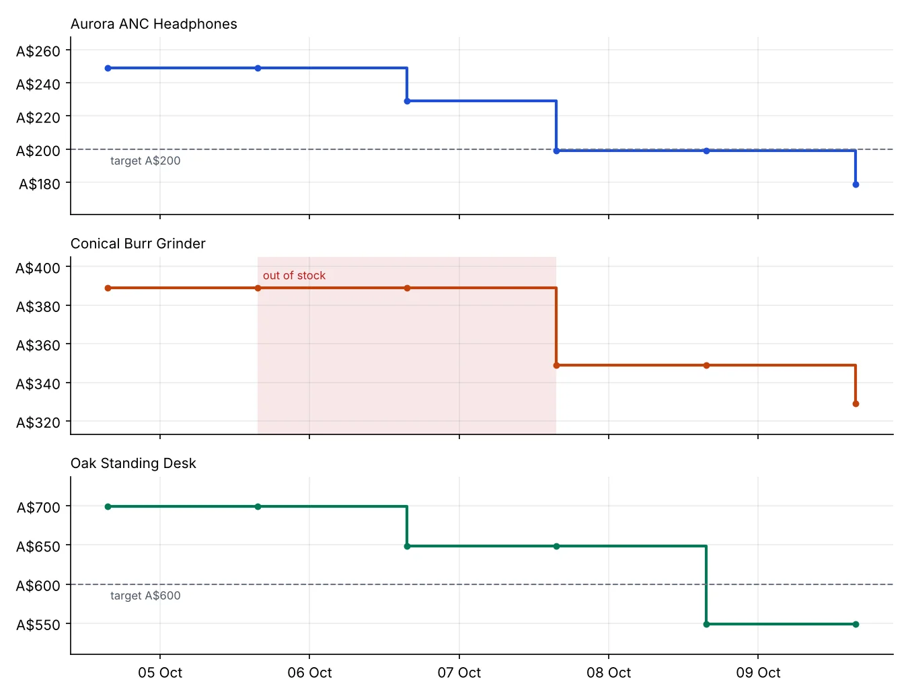
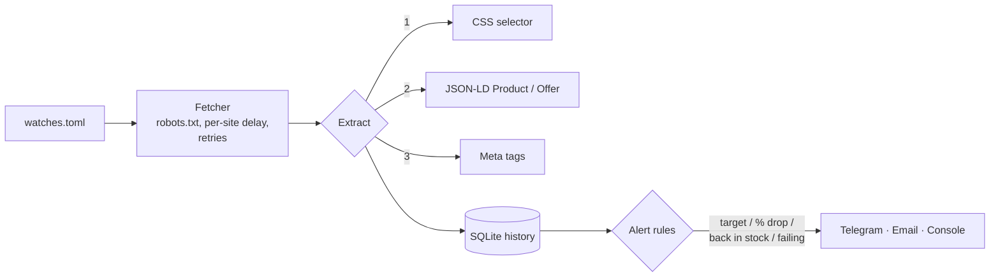

# Price Monitor

Watches product pages on a schedule and alerts you on **Telegram or email** when a price drops, hits your target, or an item comes **back in stock**. Keeps a full price history you can export or chart.

- Works on most online shops with **just the URL**: reads the structured data shops publish for Google (JSON-LD `Product`/`Offer`, Open Graph product tags)
- Falls back to a **CSS selector** for sites without structured data
- Alert rules per product: target price, % drop since the last check, back in stock, page failing repeatedly
- **Polite by default**: respects `robots.txt`, waits between requests to the same site, identifies itself, retries with backoff
- Price history in SQLite, CSV export, charts
- Offline **demo** with a fake shop, 24 tests, Docker-ready, MIT licensed



```text
$ python -m monitor demo
=== Check 4 ===
🔔 🎯 Aurora ANC Headphones is A$199.00 - at or below your target A$200.00
🔔 📉 Conical Burr Grinder dropped 10%: A$389.00 → A$349.00
🔔 📦 Conical Burr Grinder is back in stock at A$349.00
...
6 alerts sent. Price chart saved to demo_prices.png
```

> The demo runs a tiny local web shop (fictional products) whose prices change between checks, so it never touches a real website.

## Quick start

```bash
git clone https://github.com/buildering-dev/price-monitor.git
cd price-monitor
pip install -r requirements.txt

python -m monitor demo                      # see it work offline
python -m monitor test-url "https://..."    # check what it can read from a real product page
```

Then set up your own watch list:

```bash
cp examples/watches.example.toml watches.toml   # add your product URLs and rules
cp .env.example .env                            # add Telegram and/or email settings
python -m monitor check                         # one pass now
python -m monitor run                           # keep checking every interval_minutes
```

## Watch list

```toml
[settings]
interval_minutes = 60
min_delay_per_domain_s = 5

[[watch]]
name = "Noise-cancelling headphones"
url = "https://www.example-shop.com/products/headphones"
target_price = 299        # alert at or below this price

[[watch]]
name = "Standing desk"
url = "https://www.example-furniture.com/desk"
price_selector = "span.price"     # only needed when the shop has no structured data
stock_selector = "#availability"
drop_pct = 5                      # alert on a 5%+ drop since the last check
```

Full example: [examples/watches.example.toml](examples/watches.example.toml). Unknown settings are rejected, so typos don't fail silently.

## Commands

| Command | What it does |
|---|---|
| `python -m monitor demo` | offline demo with a fake shop and a chart |
| `python -m monitor test-url URL [--price-selector S]` | shows the title, price, stock and method it found on a page |
| `python -m monitor check` | checks every watch once |
| `python -m monitor run` | checks forever on the interval |
| `python -m monitor history` | prints every check |
| `python -m monitor export --out prices.csv` | price history as CSV (for Excel or Google Sheets) |
| `python -m monitor chart --out prices.png` | price-history chart with target lines |

## How it works



- `monitor/fetch.py` - polite HTTP client: robots.txt, per-domain delay, retries on 429/5xx, no retries on 404
- `monitor/extract.py` - price and stock from JSON-LD, meta tags or CSS; parses `$1,299.00`, `1.299,00 €`, `From $10.50`
- `monitor/core.py` - one pass per watch; `evaluate()` is a pure function holding all the alert rules
- `monitor/store.py` - SQLite history, last good reading, failure streaks
- `monitor/alerts.py` - Telegram, SMTP email, console; a failed alert never stops monitoring

## Run it 24/7

Any small server or VPS works (about US$5/month). With Docker:

```bash
docker build -t price-monitor .
docker run -d --name price-monitor --env-file .env \
  -v $(pwd)/watches.toml:/app/watches.toml -v $(pwd)/data:/app/data price-monitor
```

Or a cron job: `0 * * * * cd /path/to/price-monitor && python -m monitor check`.

## Responsible use

Check each site's terms before monitoring it, keep the interval sensible (hourly is plenty for prices), and don't remove the per-site delay or robots.txt check. This tool reads public product pages; it doesn't log in, bypass bot protection or collect personal data. Pages that build their prices in the browser with JavaScript need a headless-browser fetcher (for example Playwright), which can be added behind the same interface.

## Tests

```bash
pip install -r requirements-dev.txt
pytest
```

## License

MIT
